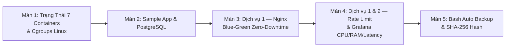

# KỊCH BẢN TỪNG BƯỚC CHI TIẾT DEMO ĐỒ ÁN CHO THẦY CÔ
## Đề Tài: "Configure and Deploy DevOps Services in Linux"
**Học phần:** Linux & Phần Mềm Nguồn Mở  
**Hệ điều hành thực nghiệm:** Ubuntu Server 22.04 / 24.04 LTS  
**Trọng tâm trình bày:** 2 Dịch vụ cốt lõi (**Nginx Gateway & Blue-Green HA** và **Prometheus & Grafana Monitoring**) + **Bash Automation Scripts**  
**Thời lượng demo khuyến nghị:** 5 – 7 phút

---

## 0. BƯỚC CHUẨN BỊ TRƯỚC GIỜ G (CHECKLIST 2 PHÚT)

Trước khi đến lượt nhóm lên trình bày, hãy mở sẵn:

### 1. Chuẩn bị 4 Tab trình duyệt trên máy:
- **Tab 1 - Web Dashboard chính:** [http://localhost:8088/](http://localhost:8088/) *(hoặc `http://localhost/` tùy biến `HOST_HTTP_PORT`)*
- **Tab 2 - Swagger API Docs:** [http://localhost:8088/docs](http://localhost:8088/docs)
- **Tab 3 - Grafana Monitoring Dashboard:** [http://localhost:3000](http://localhost:3000) *(User: `admin` / Password: `admin_devops_password`)*
- **Tab 4 - Prometheus Scrape Targets:** [http://localhost:9090/targets](http://localhost:9090/targets)

### 2. Chuẩn bị 1 cửa sổ Terminal tại thư mục dự án:
```bash
cd "/home/quan/Nam 3/linux va phan mem mo nguon/DoAnCuoiKi"
```

---

## KỊCH BẢN TRÌNH DIỄN 5 MÀN CHIẾN LƯỢC



---

### MÀN 1: GIỚI THIỆU TỔNG QUAN & KIỂM TRA HẠ TẦNG LINUX
**Mục tiêu:** Chứng minh hệ thống gọn nhẹ gồm **7 containers** tập trung vào 2 dịch vụ DevOps cốt lõi, vận hành ổn định với giới hạn Cgroups v2.

1. **Thao tác Terminal:**
   ```bash
   ./scripts/service_manager.sh status
   ```

2. **Lời thoại thuyết minh cho thầy nghe:**
   > *"Thưa thầy, tiếp thu góp ý của thầy về việc tập trung chiều sâu, nhóm em đã tinh gọn hệ thống xuống còn **7 containers nhẹ nhàng**, xoay quanh **2 dịch vụ DevOps cốt lõi**:*
   > 1. * **Nginx Gateway** (Reverse Proxy, Rate Limit, Blue-Green Zero-Downtime).*
   > 2. * **Prometheus + Node Exporter + Grafana** (Giám sát tài nguyên OS Linux và hiệu năng API).*
   > - *Còn FastAPI và PostgreSQL chỉ đóng vai trò ứng dụng mẫu để kiểm thử. Toàn bộ container đều được áp dụng **Linux Cgroups v2** giới hạn CPU/RAM và cô lập DB trong mạng nội bộ `backend_net`."*

---

### MÀN 2: KIỂM THỬ ỨNG DỤNG MẪU & POSTGRESQL
**Mục tiêu:** Chứng minh Nginx Proxy truyền request chuẩn xác vào Backend và lưu trữ bền vững trong PostgreSQL.

1. **Thao tác trên Trình duyệt:**
   - Chuyển sang **Tab 1** ([http://localhost:8088/](http://localhost:8088/)).
   - Tại tab **"1. Dữ Liệu & Dịch Vụ"**, nhập một bản ghi mới:
     - **Tên tác vụ:** `Tối ưu Linux Kernel Buffer`
     - **Mô tả:** `Cấu hình somaxconn 65535 và tcp_tw_reuse cho Nginx Proxy`
     - Nhấn nút **"Lưu Vào Database"**. Bản ghi mới xuất hiện tức thì trên bảng.

2. **Kiểm tra nhanh dữ liệu thật trong PostgreSQL (tùy chọn):**
   ```bash
   PGPASSWORD=devops_secure_pass_2026 psql -h 127.0.0.1 -p 5433 -U postgres -d devops_db -c "SELECT id, name, created_at FROM items ORDER BY id DESC LIMIT 3;"
   ```

---

### MÀN 3: DỊCH VỤ TRỌNG TÂM 1 — NGINX BLUE-GREEN ZERO-DOWNTIME DEPLOYMENT
**Mục tiêu:** Trình diễn kỹ thuật nâng cấp phiên bản không làm rớt kết nối người dùng (`0ms downtime`) nhờ tín hiệu `POSIX SIGHUP`.

1. **Quan sát trước khi chạy:**
   - Trên Web Dashboard, chỉ cho thầy badge góc trên: **`BLUE NODE ACTIVE`** (hoặc `GREEN NODE ACTIVE`).

2. **Thao tác Terminal:**
   ```bash
   ./scripts/blue_green_deploy.sh 1.0.3
   ```

3. **Lời thoại thuyết minh từng bước cho thầy thấy:**
   > - *"Hiện tại node **BLUE** đang phục vụ khách. Script bắt đầu khởi chạy node **GREEN** trên cổng nội bộ `8002`."*
   > - *(Khi terminal chạy `Probe [1/5]`...)*: *"Hệ thống thực hiện **5 lần Healthcheck Probe** tới `/health`. Chỉ khi node mới trả về HTTP 200 OK, quá trình chuyển mạch mới diễn ra."*
   > - *(Khi terminal chạy `nginx -s reload`)*: *"Script cập nhật tệp `00-upstream.conf` và gửi tín hiệu **`POSIX SIGHUP`** tới Nginx Master Process. Nginx sinh Worker mới đón khách mới và giữ Worker cũ phục vụ nốt các request dang dở $\rightarrow$ **0ms gián đoạn**."*
   > - *(Khi terminal chạy `Graceful Draining 5s`)*: *"Đợi 5 giây hoàn tất kết nối cũ rồi dừng node cũ để tiết kiệm RAM cho Linux."*

4. **Xác nhận kết quả:**
   - Quay lại Web Dashboard, nhấn **F5**: Badge đổi sang **`GREEN NODE ACTIVE`** (hoặc ngược lại).

---

### MÀN 4: DỊCH VỤ TRỌNG TÂM 2 — RATE LIMITING & GRAFANA REAL-TIME METRICS
**Mục tiêu:** Chứng minh Nginx tự bảo vệ trước lưu lượng bất thường (`HTTP 429`) và Prometheus/Grafana hiển thị ngay biến động CPU, RAM, Request Rate và Latency.

1. **Chuẩn bị màn hình:**
   - Mở sẵn **Tab 3 - Grafana Dashboard** ([http://localhost:3000](http://localhost:3000)).
   - Vào dashboard **DevOps Linux Monitoring (Nginx & OS Metrics)**, bật auto-refresh `5s`.

2. **Thao tác Terminal:**
   ```bash
   ./scripts/benchmark_stress.sh
   ```

3. **Chỉ điểm nhấn trên màn hình cho thầy xem:**
   - **Trên Terminal:** Nginx cho qua các request hợp lệ đầu tiên (`200`), sau đó chặn ngay bằng **`HTTP 429 Too Many Requests`**.
   - **Trên Grafana (4 biểu đồ cốt lõi):**
     - **Host CPU & Host Memory (Node Exporter):** Tăng vọt tại thời điểm test tải.
     - **Request Rate by Status Code:** Xuất hiện đường sóng mang nhãn `[HTTP 429]`.
     - **API Request Latency (Avg & P95 ms):** Hiển thị rõ độ trễ trung bình và bách phân vị 95.

---

### MÀN 5: TỰ ĐỘNG HÓA LINUX — AUTO BACKUP & SHA-256 CHECKSUM
**Mục tiêu:** Chứng minh kỹ năng quản trị Linux (Cronjob, piping nén luồng, phân quyền chặt chẽ, kiểm tra toàn vẹn).

1. **Thao tác Terminal:**
   ```bash
   ./scripts/auto_backup.sh && ls -la backups/
   ```

2. **Chỉ các điểm kỹ thuật Linux cho thầy:**
   - Thư mục `backups/` phân quyền **`drwx------` (`chmod 700`)**.
   - Tệp `.sql.gz` phân quyền **`-rw-------` (`chmod 600`)**.
   - Tệp `.sha256` xác thực tính toàn vẹn dữ liệu.
   - Cơ chế dọn dẹp tự động bản sao lưu cũ hơn 7 ngày (`find -mtime +7 -delete`) và chạy định kỳ lúc `02:00` qua `crontab`.

---

## 3. CHEAT-SHEET ỨNG BIẾN KHI THẦY CÔ ĐẶT CÂU HỎI

| Câu hỏi của Thầy | Cách trả lời "ăn điểm" |
| :--- | :--- |
| **Q1: Tại sao nhóm chỉ tập trung vào Nginx và Prometheus/Grafana?** | *"Dạ thưa thầy, đây là 2 dịch vụ đại diện cho 2 bài toán cốt lõi khi vận hành hệ thống trên Linux: **Cổng giao tiếp & Sẵn sàng cao (Nginx Blue-Green)** và **Giám sát tài nguyên nhân Linux (Node Exporter + Prometheus + Grafana)**. App và DB chỉ là mục tiêu mẫu để kiểm chứng 2 dịch vụ này."* |
| **Q2: Nginx reload bằng cách nào mà không rớt kết nối?** | *"Dạ thưa thầy, Nginx dùng mô hình Master–Worker và cơ chế `epoll`. Khi gửi tín hiệu `POSIX SIGHUP` (`nginx -s reload`), Master đọc lại cấu hình, tạo Worker mới đón kết nối mới, trong khi Worker cũ phục vụ xong kết nối hiện tại rồi mới tự tắt."* |
| **Q3: Node Exporter lấy thông số CPU/RAM Linux từ đâu?** | *"Dạ thưa thầy, container `node-exporter` mount read-only thư mục ảo `/proc` và `/sys` của Linux Kernel. Nó đọc trực tiếp các tệp như `/proc/stat` (CPU ticks) và `/proc/meminfo` (RAM) rồi xuất ra chuẩn metrics cho Prometheus."* |
| **Q4: Cgroups v2 giới hạn tài nguyên ở đâu?** | *"Dạ thưa thầy, trong `docker-compose.yml`, mỗi service đều có `deploy.resources.limits` quy định `cpus` và `memory`. Docker cấu hình trực tiếp Linux Cgroups v2 để áp trần tài nguyên, tránh tiến trình lỗi làm treo toàn bộ máy ảo."* |
