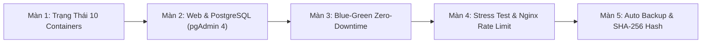

# KỊCH BẢN TỪNG BƯỚC CHI TIẾT DEMO ĐỒ ÁN CHO THẦY CÔ
## Đề Tài: "Configure and Deploy DevOps Services in Linux"
**Học phần:** Linux & Phần Mềm Nguồn Mở  
**Hệ điều hành thực nghiệm:** Ubuntu Server 22.04 / 24.04 LTS  
**Thời lượng demo khuyến nghị:** 5 – 7 phút  

---

## 0. BƯỚC CHUẨN BỊ TRƯỚC GIỜ G (CHECKLIST 2 PHÚT)

Trước khi đến lượt nhóm lên trình bày, bạn hãy mở sẵn:

### 1. Chuẩn bị 4 Tab trình duyệt trên máy:
- **Tab 1 - Web Dashboard chính:** [http://localhost:8088/](http://localhost:8088/)
- **Tab 2 - Swagger API Docs:** [http://localhost:8088/docs](http://localhost:8088/docs)
- **Tab 3 - Grafana Observability Dashboard:** [http://localhost:3000](http://localhost:3000) *(User: `admin` / Password: `admin_devops_password`)*
- **Tab 4 - Prometheus Scrape Targets:** [http://localhost:9090/targets](http://localhost:9090/targets)

### 2. Chuẩn bị 1 cửa sổ Terminal tại thư mục dự án:
```bash
cd /home/tmthang/linux
```

---

## KỊCH BẢN TRÌNH DIỄN 5 MÀN CHIẾN LƯỢC



---

### MÀN 1: GIỚI THIỆU TỔNG QUAN & KIỂM TRA HỆ THỐNG
**Mục tiêu:** Chứng minh toàn bộ 10 container dịch vụ đang vận hành ổn định trên Ubuntu Linux, tuân thủ giới hạn Cgroups v2.

1. **Thao tác Terminal:**
   ```bash
   ./scripts/service_manager.sh status
   ```

2. **Lời thoại thuyết minh cho thầy nghe:**
   > *"Thưa thầy, hệ thống của nhóm chúng em hiện đang vận hành 10 microservices được điều phối bằng Docker Compose. Trong màn hình này, thầy có thể thấy:*
   > - *Cổng Nginx Gateway chính lắng nghe ở port **8088**.*
   > - *Toàn bộ các container đều được áp dụng **Linux Cgroups v2** để giới hạn trần CPU và RAM (FastAPI 512MB, Database 512MB, Loki < 200MB).*
   > - *Đặc biệt, cơ sở dữ liệu PostgreSQL nằm trong phân vùng mạng `backend_net` với thuộc tính `internal: true`, cô lập hoàn toàn khỏi Internet theo nguyên lý **Defense in Depth**."*

---

### MÀN 2: THAO TÁC WEB DASHBOARD & TRUY VẤN DATABASE (PGADMIN 4)
**Mục tiêu:** Chứng minh ứng dụng hoạt động thực tế, dữ liệu được ghi và đọc trực tiếp từ PostgreSQL thật qua kết nối cổng 5433.

1. **Thao tác trên Trình duyệt:**
   - Chuyển sang **Tab 1** ([http://localhost:8088/](http://localhost:8088/)).
   - Tại tab **"1. Ứng Dụng & Dữ Liệu"**, nhập một bản ghi mới:
     - **Tên tác vụ:** `Tối ưu Linux Kernel Buffer`
     - **Mô tả:** `Cấu hình somaxconn 65535 và tcp_tw_reuse cho Nginx Proxy`
     - Nhấn nút: **"Lưu Vào Database"**. Bản ghi mới xuất hiện tức thì trên bảng.

2. **Thao tác chứng minh với PostgreSQL thật:**
   - **Cách 1 (Bằng pgAdmin 4):** Mở pgAdmin 4, kết nối tới Server `DevOps Docker DB` (Port `5433`, Database `devops_db`, Pass `devops_secure_pass_2026`). Chuột phải bảng `items` $\rightarrow$ chọn **View/Edit Data** $\rightarrow$ Thầy sẽ thấy bản ghi vừa tạo xuất hiện ngay trong DB.
   - **Cách 2 (Bằng Terminal nhanh nếu không muốn mở app):**
     ```bash
     PGPASSWORD=devops_secure_pass_2026 psql -h 127.0.0.1 -p 5433 -U postgres -d devops_db -c "SELECT id, name, created_at FROM items ORDER BY id DESC LIMIT 3;"
     ```

3. **Lời thoại thuyết minh cho thầy nghe:**
   > *"Dữ liệu được lưu trữ bền vững qua Docker volume `devops_pg_data`. Nhóm đã mở thêm cổng 5433 trên máy chủ để kết nối trực tiếp với công cụ quản trị chuyên nghiệp pgAdmin 4 mà không xung đột với port 5432 cục bộ."*

---

### MÀN 3: ĐIỂM SÁNG ĂN ĐIỂM - BLUE-GREEN ZERO-DOWNTIME DEPLOYMENT
**Mục tiêu:** Trình diễn tính năng nâng cấp phiên bản ứng dụng mà **không làm gián đoạn người dùng (0ms downtime)** bằng tín hiệu POSIX SIGHUP.

1. **Quan sát trước khi chạy:**
   - Trên Web Dashboard ([http://localhost:8088/](http://localhost:8088/)), chỉ cho thầy thấy badge góc trên: **`BLUE ACTIVE`** (hoặc `GREEN ACTIVE`).

2. **Thao tác Terminal:**
   Chạy lệnh chuyển mạch Blue-Green sang phiên bản mới:
   ```bash
   ./scripts/blue_green_deploy.sh 1.0.3
   ```

3. **Lời thoại thuyết minh từng bước trên Terminal cho thầy thấy:**
   > - *"Thưa thầy, hiện tại container **BLUE** đang nhận khách. Nhóm bắt đầu khởi chạy container **GREEN** trên cổng nội bộ 8002."*
   > - *(Khi terminal hiện `Probe [1/5]`...)*: *"Hệ thống không vội chuyển khách ngay mà thực hiện **5 lần Healthcheck Probe**. Đến khi container mới phản hồi HTTP 200 OK, quá trình chuyển đổi mới được kích hoạt."*
   > - *(Khi terminal hiện `nginx -s reload`)*: *"Tại bước này, script cập nhật file `00-upstream.conf` và gửi tín hiệu **POSIX SIGHUP** tới tiến trình Master của Nginx. Nginx nạp lại cấu hình ngay trong RAM, **đảm bảo 0ms gián đoạn kết nối**."*
   > - *(Khi terminal hiện `Graceful Draining 5s`)*: *"Nginx đợi 5 giây để các request dang dở xử lý xong, sau đó script mới tắt container cũ để giải phóng RAM cho Linux."*

4. **Xác nhận kết quả:**
   - Quay lại Web ([http://localhost:8088/](http://localhost:8088/)), nhấn **F5**: Badge lập tức đổi sang **`GREEN ACTIVE`** (hoặc ngược lại) mà không bị lỗi mạng dù chỉ 1 giây!

---

### MÀN 4: GIẢ LẬP TẢI CAO (STRESS TEST) & NGINX RATE LIMITING (HTTP 429) + GRAFANA
**Mục tiêu:** Chứng minh năng lực tự bảo vệ của Nginx trước tấn công DoS và khả năng giám sát tập trung bằng Prometheus & Grafana Loki.

1. **Chuẩn bị màn hình:**
   - Mở sẵn **Tab 3 - Grafana Dashboard** ([http://localhost:3000](http://localhost:3000)).
   - Vào dashboard **DevOps Linux Full Observability (Metrics & Logs)**, để chế độ auto-refresh là `5s`.

2. **Thao tác Terminal:**
   Chạy script giả lập 500 requests dồn dập:
   ```bash
   ./scripts/benchmark_stress.sh
   ```

3. **Chỉ điểm nhấn trên màn hình cho thầy xem:**
   - **Trên Terminal:** Nginx trả về các mã `200` lúc đầu, sau đó chặn đứng bằng mã **`429 Too Many Requests`**.
   - **Trên Grafana:**
     - Biểu đồ **Linux Host CPU** và **Container Memory (cAdvisor)** nhảy vọt bước sóng spike.
     - Biểu đồ **FastAPI Request Rate** hiển thị các đường sóng màu tím/đỏ mang mã `[429]`.
     - Panel dưới cùng **Centralized Live Logs Stream (Loki)**: Dòng log JSON màu đỏ ghi lại chính xác IP, thời gian và mã trạng thái 429 của Nginx.

4. **Lời thoại thuyết minh cho thầy nghe:**
   > *"Ở tầng Gateway, Nginx được cấu hình Rate Limit zone giới hạn 15 req/s với burst 10. Khi có lưu lượng bất thường, hệ thống tự động bảo vệ backend bằng mã HTTP 429. Mọi biến động tài nguyên và nhật ký truy cập đều được Loki và Prometheus ghi nhận theo thời gian thực mà quản trị viên không cần truy cập thủ công vào server."*

---

### MÀN 5: TỰ ĐỘNG HÓA LINUX: AUTO BACKUP & TÍNH TOÀN VẸN SHA-256
**Mục tiêu:** Chứng minh khả năng tự động sao lưu dữ liệu, bảo mật phân quyền Linux và kiểm soát tính toàn vẹn file.

1. **Thao tác Terminal:**
   ```bash
   ./scripts/auto_backup.sh
   ```

2. **Kiểm tra kết quả sao lưu:**
   ```bash
   ls -la backups/
   ```

3. **Chỉ cho thầy các điểm kỹ thuật chuẩn Linux:**
   - Thư mục `backups/` có phân quyền **`drwx------` (chmod 700)**: Chỉ user sở hữu được xem.
   - File nén `.sql.gz` có phân quyền **`-rw-------` (chmod 600)**.
   - File `.sha256`: Chứa mã băm SHA-256 chứng minh bản sao lưu không bị can thiệp hay sửa đổi mã độc.
   - Cơ chế tự động dọn dẹp các bản backup cũ hơn 7 ngày (`find -mtime +7 -delete`).

4. **Lời thoại kết thúc:**
   > *"Script sao lưu này đã được cấu hình tự động chạy vào lúc 02:00 sáng hàng ngày qua Cronjob Linux. Dữ liệu được nén dạng luồng `gzip -9` chỉ mất chưa đầy 1 giây, có kiểm tra mã hash SHA-256 và chính sách tự động xóa sau 7 ngày để tối ưu dung lượng ổ cứng."*

---

## 3. CHEAT-SHEET ỨNG BIẾN KHI THẦY CÔ ĐẶT CÂU HỎI

| Câu hỏi của Thầy | Cách trả lời "ăn điểm" |
| :--- | :--- |
| **Q1: Tại sao dùng Blue-Green mà không dùng Rolling Update?** | *"Dạ thưa thầy, Rolling Update có giai đoạn cả 2 phiên bản cũ và mới chạy song song cùng nhận khách, dễ gây xung đột schema Database. Blue-Green cho phép cô lập hoàn toàn node mới để kiểm tra sức khỏe trước, khi đạt chuẩn mới chuyển 100% khách sang nên đảm bảo tính toàn vẹn cao hơn."* |
| **Q2: Nginx reload bằng cách nào mà không rớt kết nối?** | *"Dạ thưa thầy, Nginx sử dụng kiến trúc Master-Worker. Khi gửi tín hiệu `POSIX SIGHUP` (`nginx -s reload`), Master process sẽ đọc lại file cấu hình, sinh ra các Worker process mới để đón khách mới, trong khi các Worker cũ vẫn duy trì phục vụ các kết nối in-flight hiện tại rồi mới tự kết thúc."* |
| **Q3: Làm sao ngăn chặn Hacker truy cập trực tiếp vào Database?** | *"Dạ thưa thầy, container PostgreSQL nằm trong Docker network `backend_net` với tùy chọn `internal: true`. Docker daemon cấu hình iptables chặn toàn bộ gói tin đi từ bên ngoài vào mạng này. Chỉ có các container trong cùng mạng nội bộ mới được giao tiếp qua port 5432."* |
| **Q4: Cgroups v2 giới hạn tài nguyên ở đâu?** | *"Dạ thưa thầy, trong file `docker-compose.yml`, mỗi service đều có khối `deploy.resources.limits` quy định `cpus` và `memory`. Docker daemon sẽ giao tiếp trực tiếp với Linux Cgroups v2 trong kernel `/sys/fs/cgroup` để giới hạn trần tài nguyên, tránh OOM Killer làm sập server."* |
