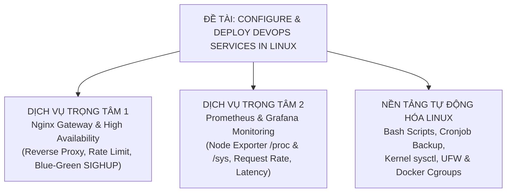

# Vai Trò & Mục Tiêu Kỹ Thuật Của Đề Tài
## Đề Tài: "Configure and Deploy DevOps Services in Linux"
**Học phần:** Linux & Phần Mềm Nguồn Mở  
**Hệ điều hành mục tiêu:** Ubuntu Server 22.04 / 24.04 LTS  

---

## 1. Đặt Vấn Đề & Phạm Vi Trọng Tâm

Trong môi trường triển khai dịch vụ trên Linux, quản trị viên thường đối mặt với hai bài toán lớn nhất:
1. **Đảm bảo dịch vụ web vận hành liên tục, chịu tải và an toàn khi cập nhật:** Tránh tình trạng rớt kết nối (downtime) mỗi khi nâng cấp code mới hoặc bị tấn công làm quá tải cổng web.
2. **Giám sát minh bạch sức khỏe hệ điều hành và lưu lượng truy cập:** Quản trị viên cần nắm bắt kịp thời mức tiêu thụ CPU/RAM của nhân Linux cũng như tốc độ phản hồi và tỷ lệ lỗi của API.

**Định hướng của đề tài:**  
Thay vì cài đặt dàn trải quá nhiều dịch vụ phụ trợ gây loãng trọng tâm, nhóm tập trung thiết kế chuyên sâu vào **2 Dịch vụ Nguồn Mở Cốt Lõi trên Linux**, kết hợp với bộ **Shell Scripts tự động hóa quản trị Linux**:

*(Ứng dụng FastAPI và cơ sở dữ liệu PostgreSQL 16 được sử dụng làm **Sample Application Target** để kiểm chứng thực tế luồng truy cập qua Nginx và số liệu thu thập trên Grafana).*

---

## 2. Chi Tiết Hai Dịch Vụ Trọng Tâm & Tự Động Hóa Linux

### Dịch Vụ Trọng Tâm 1: Nginx Gateway & High Availability (Zero-Downtime)
- **Tối ưu I/O cấp Kernel ([nginx/nginx.conf](nginx/nginx.conf)):** Sử dụng mô hình sự kiện bất đồng bộ **`use epoll`**, `worker_processes auto`, `worker_rlimit_nofile 65535`, `sendfile on`, `tcp_nopush on`, `tcp_nodelay on` và nén `gzip`.
- **Bảo mật & Chống quá tải ([nginx/conf.d/app.conf](nginx/conf.d/app.conf)):**
  - Thiết lập **Rate Limiting Zone** (`15 requests/s`, `burst=10 nodelay`) lưu bảng băm IP trong RAM chia sẻ, tự động chặn lưu lượng vượt ngưỡng bằng mã `HTTP 429`.
  - Áp dụng OWASP Security Headers (`X-Frame-Options`, `X-Content-Type-Options`, `X-XSS-Protection`, `Referrer-Policy`) và giới hạn truy cập `/metrics` chỉ cho mạng nội bộ.
- **Chuyển mạch Blue-Green không gián đoạn ([scripts/blue_green_deploy.sh](scripts/blue_green_deploy.sh)):**
  - Duy trì 2 node tách biệt (`app_blue` :8001 và `app_green` :8002).
  - Kiểm tra sức khỏe 5 lần qua HTTP probe trước khi cập nhật [nginx/conf.d/00-upstream.conf](nginx/conf.d/00-upstream.conf).
  - Gửi tín hiệu **`POSIX SIGHUP`** (`nginx -s reload`) cho tiến trình Master của Nginx nạp lại cấu hình ngay trong RAM (**0ms downtime**), đợi 5 giây graceful draining rồi mới dừng container cũ.

### Dịch Vụ Trọng Tâm 2: Giám Sát Hệ Thống (Prometheus + Node Exporter + Grafana)
- **Thu thập thông số Linux Host ([docker-compose.yml](docker-compose.yml)):** `Node Exporter` đọc trực tiếp từ các hệ thống tệp ảo của nhân Linux (`/proc`, `/sys`) để cung cấp thông số CPU, RAM và dung lượng sử dụng theo thời gian thực.
- **Thu thập hiệu năng dịch vụ ([monitoring/prometheus/prometheus.yml](monitoring/prometheus/prometheus.yml)):** `Prometheus` cào dữ liệu từ `node_exporter` (chu kỳ 5s) và middleware `fastapi_app` (chu kỳ 3s), lưu trữ trên chuỗi thời gian TSDB (15 ngày).
- **Trực quan hóa Grafana ([devops_overview.json](monitoring/grafana/provisioning/dashboards/devops_overview.json)):** Nạp tự động (Auto-provisioning) dashboard gồm 4 biểu đồ trọng tâm:
  1. `Linux Host CPU Usage (%)`
  2. `Linux Host Memory Usage (MB)`
  3. `Nginx & FastAPI Request Rate by Status Code (req/s)` (theo dõi 200 vs 429)
  4. `API Request Latency (Avg & P95 ms)`

### Nền Tảng Quản Trị & Tự Động Hóa Linux (Bash Scripts & OS Hardening)
- **Tối ưu & Bảo mật hệ điều hành ([scripts/setup_server.sh](scripts/setup_server.sh)):** Cấu hình tường lửa `UFW`, cài `fail2ban`, tinh chỉnh thông số mạng nhân Linux tại `/etc/sysctl.d/99-devops.conf` (`somaxconn=65535`, `tcp_tw_reuse=1`, `fs.file-max=2097152`).
- **Công cụ CLI quản trị runtime ([scripts/service_manager.sh](scripts/service_manager.sh)):** Menu tương tác và cờ lệnh cho phép kiểm tra tài nguyên Cgroups (`docker stats`), kiểm tra socket (`ss -tulpn`), đổi port động, chuyển đổi môi trường Staging/Production và reload Nginx.
- **Sao lưu & Toàn vẹn dữ liệu ([scripts/auto_backup.sh](scripts/auto_backup.sh)):** Lập lịch tự động qua `crontab` lúc `02:00` sáng: xuất dữ liệu PostgreSQL nén luồng `gzip -9`, tạo mã băm `sha256sum`, phân quyền bảo mật `chmod 700/600`, xóa bản sao lưu quá 7 ngày và thông báo qua Telegram Bot.

---

## 3. Bảng Ánh Xạ Bài Toán Thực Tế & Giải Pháp Linux

| Bài toán vận hành trên Linux | Giải pháp kỹ thuật được triển khai | Thành phần phụ trách |
| :--- | :--- | :--- |
| Cập nhật dịch vụ không downtime | Blue-Green Deployment, Nginx dynamic upstream, tín hiệu `POSIX SIGHUP` | [scripts/blue_green_deploy.sh](scripts/blue_green_deploy.sh), [00-upstream.conf](nginx/conf.d/00-upstream.conf) |
| Chống quá tải / DoS ở tầng Web | Nginx `epoll` + Rate Limiting (`15r/s`, `HTTP 429`) | [nginx/nginx.conf](nginx/nginx.conf), [nginx/conf.d/app.conf](nginx/conf.d/app.conf) |
| Giám sát CPU, RAM OS & Độ trễ API | `Node Exporter` (`/proc`, `/sys`) + `Prometheus` + `Grafana` (4 panels) | [prometheus.yml](monitoring/prometheus/prometheus.yml), [devops_overview.json](monitoring/grafana/provisioning/dashboards/devops_overview.json) |
| Bảo vệ tài nguyên & cô lập DB | Docker Cgroups limits + Bridge network `internal: true` | [docker-compose.yml](docker-compose.yml) |
| Sao lưu định kỳ & chống sửa đổi file | `Cronjob` + `pg_dump \| gzip -9` + `sha256sum` + `chmod 700/600` | [scripts/auto_backup.sh](scripts/auto_backup.sh) |
| Tối ưu tham số mạng nhân Linux | Kernel `sysctl` tuning + `UFW` firewall | [scripts/setup_server.sh](scripts/setup_server.sh) |
