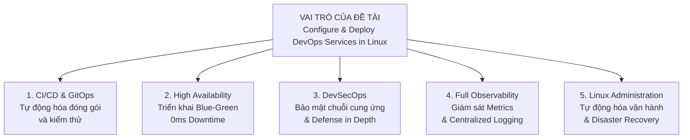

# Vai Trò & Mục Tiêu Kỹ Thuật Của Đề Tài
## Đề Tài: "Configure and Deploy DevOps Services in Linux"
**Học phần:** Linux & Phần Mềm Nguồn Mở  
**Hệ điều hành mục tiêu:** Ubuntu Server 22.04 / 24.04 LTS  

---

## 1. Đặt Vấn Đề & Mục Tiêu Cốt Lõi

Trong môi trường triển khai phần mềm truyền thống trên Linux, các nhóm phát triển và vận hành (Dev và Ops) thường đối mặt với các thách thức lớn:
- **Hiện tượng "Chạy được trên máy Dev nhưng lỗi trên Server":** Sự thiếu đồng nhất về môi trường, thư viện và phiên bản hệ điều hành.
- **Gián đoạn dịch vụ khi cập nhật (Downtime):** Mỗi lần triển khai tính năng mới hoặc sửa lỗi, hệ thống phải dừng dịch vụ, làm rớt kết nối của người dùng.
- **Rủi ro an ninh chuỗi cung ứng (DevSecOps):** Nguy cơ vô tình commit mật khẩu/token vào kho mã nguồn hoặc sử dụng các image cơ sở chứa lỗ hổng bảo mật nghiêm trọng (CVE).
- **Thiếu khả năng giám sát tập trung (Observability):** Quản trị viên không nắm bắt được tài nguyên CPU/RAM tiêu thụ, không phát hiện kịp thời các lỗi nội bộ hoặc các đợt tấn công DoS/lạm dụng API.
- **Vận hành thủ công tốn thời gian:** Thao tác sao lưu cơ sở dữ liệu, dọn dẹp dung lượng đĩa và rollback khi có sự cố còn thực hiện bằng tay, dễ phát sinh lỗi con người.

**Mục tiêu cốt lõi của đề tài:**  
Xây dựng một **Kiến Trúc Mẫu DevOps (DevOps Reference Architecture)** hoàn chỉnh, chuẩn hóa 100% trên nền tảng Linux và hoàn toàn bằng **phần mềm nguồn mở (Open Source)**. Đề tài bao phủ toàn diện vòng đời của một dịch vụ: từ kiểm thử mã nguồn, quét an ninh, đóng gói container, chuyển mạch không gián đoạn, đến giám sát thời gian thực và tự động hóa khôi phục sau sự cố.

---

## 2. Năm Trụ Cột Kỹ Thuật Trọng Tâm Của Đề Tài

---

### Trụ Cột 1: Tự Động Hóa Chu Trình Phát Triển & Phát Hành (CI/CD & GitOps)
* **Vấn đề giải quyết:** Loại bỏ thao tác triển khai thủ công qua SSH/FTP, đảm bảo mọi dòng mã nguồn đều được kiểm tra nghiêm ngặt trước khi đưa vào vận hành.
* **Vai trò trong dự án:**
  - Thiết lập pipeline tự động hóa qua [.gitea/workflows/deploy.yaml](.gitea/workflows/deploy.yaml) và [.github/workflows/deploy.yaml](.github/workflows/deploy.yaml).
  - Tự động kiểm tra chuẩn mực code Python (`Flake8 PEP8`, giới hạn độ phức tạp mã nguồn).
  - Khởi chạy bộ kiểm thử tự động [app/tests/test_main.py](app/tests/test_main.py) bằng `pytest` để kiểm tra tính toàn vẹn của API trước khi build image.
  - Tự động đóng gói ứng dụng qua [app/Dockerfile](app/Dockerfile) sử dụng kỹ thuật **Multi-stage build** giúp tối ưu dung lượng image và tăng tốc độ triển khai.

---

### Trụ Cột 2: Đảm Bảo Tính Sẵn Sàng Cao (High Availability & Zero-Downtime Deployment)
* **Vấn đề giải quyết:** Xóa bỏ thời gian chết (downtime) của hệ thống khi cập nhật phiên bản phần mềm mới.
* **Vai trò trong dự án:**
  - Áp dụng mô hình **Blue-Green Deployment** thông qua tập lệnh [scripts/blue_green_deploy.sh](scripts/blue_green_deploy.sh) phối hợp với Nginx dynamic upstream [nginx/conf.d/00-upstream.conf](nginx/conf.d/00-upstream.conf).
  - Luôn duy trì 2 node độc lập: Node hiện hành (**Active**) và Node chuẩn bị cập nhật (**Target**).
  - Thực hiện **5 lần kiểm tra sức khỏe (Healthcheck Probes)** trên cổng nội bộ trước khi chuyển hướng người dùng.
  - Sử dụng tín hiệu nhân Linux **POSIX SIGHUP** để yêu cầu tiến trình Master của Nginx nạp lại cấu hình upstream ngay trong bộ nhớ, chuyển 100% lưu lượng truy cập sang phiên bản mới với **0ms gián đoạn**.
  - Thiết lập cơ chế **Graceful Connection Draining** chờ các kết nối in-flight hoàn tất trước khi dừng container cũ nhằm giải phóng bộ nhớ RAM Linux.

---

### Trụ Cột 3: Tích Hợp An Ninh Đa Tầng (DevSecOps & Defense in Depth)
* **Vấn đề giải quyết:** Ngăn chặn lộ lọt thông tin nhạy cảm và bảo vệ hạ tầng máy chủ trước các nguy cơ tấn công mạng.
* **Vai trò trong dự án:**
  - **Quét mã nguồn tĩnh:** Tích hợp công cụ [Gitleaks](.gitleaks.toml) quét toàn bộ lịch sử commit Git để phát hiện và ngăn chặn việc lọt lộ mật khẩu, API key hoặc Private Key.
  - **Quét lỗ hổng Container:** Sử dụng bộ quét an ninh **Aqua Trivy** kiểm tra base image và thư viện phụ thuộc; tự động **chặn đứng (block) pipeline CI/CD** và gửi cảnh báo khẩn cấp về Telegram nếu phát hiện lỗ hổng mức độ `CRITICAL`.
  - **Phân quyền tối thiểu (Least Privilege):** Docker container của ứng dụng chạy dưới quyền tài khoản không đặc quyền (`USER appuser`, UID 10001), hạn chế rủi ro leo thang đặc quyền (container escape).
  - **Cô lập phân vùng mạng (Network Segmentation):** Tách biệt hệ thống thành 3 mạng Docker bridge; cơ sở dữ liệu PostgreSQL nằm trong `devops_backend_net` với thuộc tính `internal: true`, chặn hoàn toàn việc định tuyến trực tiếp từ Internet vào DB.
  - **Chống DoS / Brute-force:** [nginx/nginx.conf](nginx/nginx.conf) thiết lập bộ nhớ Rate Limiting Zone (`15 requests/s`, burst `10 nodelay`), tự động phản hồi `HTTP 429 Too Many Requests` khi lưu lượng vượt ngưỡng an toàn.

---

### Trụ Cột 4: Giám Sát Toàn Diện & Nhật Ký Tập Trung (Full Observability)
* **Vấn đề giải quyết:** Cung cấp cho kỹ sư SRE và Quản trị viên hệ thống bức tranh thời gian thực về tình trạng sức khỏe và hiệu năng của toàn bộ hạ tầng.
* **Vai trò trong dự án:**
  - **Giám sát số liệu hiệu năng (Metrics Engine):** [monitoring/prometheus/prometheus.yml](monitoring/prometheus/prometheus.yml) tự động thu thập metrics phần cứng OS từ `Node Exporter`, thông số cgroups container từ `cAdvisor`, và lưu lượng/độ trễ HTTP từ middleware `fastapi_app`.
  - **Thu thập nhật ký tập trung (Centralized Logging):** [monitoring/promtail/promtail-config.yml](monitoring/promtail/promtail-config.yml) thu thập JSON access logs từ Nginx và toàn bộ stdout/stderr của các container qua Docker socket, đẩy về kho lưu trữ [monitoring/loki/loki-config.yml](monitoring/loki/loki-config.yml). Hệ thống tối ưu hóa tài nguyên RAM (< 200MB) và có chính sách tự động xóa log cũ sau 7 ngày (`retention_period: 168h`).
  - **Bảng điều khiển trực quan:** [monitoring/grafana/provisioning/dashboards/devops_overview.json](monitoring/grafana/provisioning/dashboards/devops_overview.json) nạp sẵn dashboard thống nhất hiển thị biểu đồ CPU, RAM, tỷ lệ request theo mã HTTP (200, 429, 500) và live log stream có hỗ trợ lọc từ khóa.

---

### Trụ Cột 5: Tự Động Hóa Vận Hành Linux & Khôi Phục Thảm Họa (Disaster Recovery)
* **Vấn đề giải quyết:** Giảm thiểu sự can thiệp thủ công trong các tác vụ bảo trì định kỳ và đảm bảo an toàn tuyệt đối cho dữ liệu.
* **Vai trò trong dự án:**
  - **Tối ưu hóa Kernel:** [scripts/setup_server.sh](scripts/setup_server.sh) cấu hình các tham số nhân Linux tại `/etc/sysctl.d/99-devops.conf` (`somaxconn`, `tcp_max_syn_backlog`, `tcp_tw_reuse`, `fs.file-max`) giúp máy chủ chịu tải cao cho Reverse Proxy.
  - **Menu quản trị runtime:** [scripts/service_manager.sh](scripts/service_manager.sh) cung cấp giao diện CLI tương tác cho phép xem tài nguyên cgroups thời gian thực, đổi cổng HTTP, chuyển đổi môi trường (Staging/Production), nạp lại Nginx không downtime.
  - **Sao lưu tự động & Toàn vẹn dữ liệu:** [scripts/auto_backup.sh](scripts/auto_backup.sh) chạy qua Cronjob định kỳ: xuất dữ liệu PostgreSQL bằng `pg_dump`, nén luồng `gzip -9`, tạo mã băm `SHA-256`, thiết lập phân quyền Linux (`chmod 700/600`), tự động dọn dẹp các bản sao lưu cũ quá 7 ngày và gửi báo cáo về Telegram.
  - **Tự động Rollback sự cố:** [scripts/healthcheck_rollback.sh](scripts/healthcheck_rollback.sh) chủ động probe kiểm tra sau khi cập nhật; nếu phiên bản mới bị crash quá số lần cho phép, script tự động rollback về image ổn định gần nhất và thông báo cho đội ngũ vận hành.

---

## 3. Bảng Ánh Xạ Giữa Bài Toán Thực Tế & Giải Pháp Kỹ Thuật

| Bài toán thực tế trong vận hành | Giải pháp kỹ thuật được triển khai trong đề tài | Tệp / Thành phần phụ trách |
| :--- | :--- | :--- |
| Đóng gói phần mềm đồng nhất | Multi-stage Docker build, non-root user (UID 10001) | [app/Dockerfile](app/Dockerfile) |
| Cập nhật phần mềm không downtime | Blue-Green Deployment, Nginx dynamic upstream, POSIX SIGHUP reload | [scripts/blue_green_deploy.sh](scripts/blue_green_deploy.sh), [00-upstream.conf](nginx/conf.d/00-upstream.conf) |
| Bảo vệ DB khỏi truy cập bên ngoài | Cô lập mạng Docker bridge, thiết lập `internal: true` | [docker-compose.yml](docker-compose.yml) |
| Chống DoS và lạm dụng API | Nginx Rate Limiting zone `15r/s`, burst `10 nodelay`, HTTP 429 | [nginx/conf.d/app.conf](nginx/conf.d/app.conf) |
| Phát hiện lộ secret và CVE bảo mật | Gitleaks scan history + Aqua Trivy image vulnerability gate | [.github/workflows/deploy.yaml](.github/workflows/deploy.yaml), [.gitleaks.toml](.gitleaks.toml) |
| Giám sát hiệu năng hệ thống | Prometheus TSDB + Node Exporter + cAdvisor + Grafana | [monitoring/prometheus/](monitoring/prometheus/prometheus.yml), [monitoring/grafana/](monitoring/grafana/provisioning/dashboards/devops_overview.json) |
| Quản lý log phân tán | Promtail JSON Log Shipper + Grafana Loki TSDB | [monitoring/promtail/](monitoring/promtail/promtail-config.yml), [monitoring/loki/](monitoring/loki/loki-config.yml) |
| Thảm họa mất mát dữ liệu | Cronjob pg_dump gzip dạng luồng + SHA-256 Checksum + Telegram Bot | [scripts/auto_backup.sh](scripts/auto_backup.sh) |
| Sự cố phần mềm mới phát hành | Healthcheck probe tự động + Fallback auto-rollback container | [scripts/healthcheck_rollback.sh](scripts/healthcheck_rollback.sh) |
| Tối ưu hóa hiệu năng hệ điều hành | Hardening UFW firewall, fail2ban, Kernel sysctl tuning | [scripts/setup_server.sh](scripts/setup_server.sh) |

---

## 4. Ý Nghĩa Đối Với Môn Học & Thực Tiễn

### 4.1. Đối với môn học "Linux và Phần mềm Nguồn Mở"
- **Áp dụng toàn diện kiến thức hệ điều hành Linux:** Đề tài không chỉ dừng lại ở lý thuyết mà hiện thực hóa các khái niệm chuyên sâu: quản lý tiến trình và tín hiệu (`POSIX Signals`), phân quyền tệp tin và người dùng (`File Permissions & Least Privilege`), quản trị tài nguyên qua Linux Cgroups v2, tối ưu hóa thông số nhân qua `sysctl`, lập lịch định kỳ với `crontab`, và quản trị mạng máy chủ qua `UFW` & `iptables`.
- **Làm chủ hệ sinh thái nguồn mở (Open Source Ecosystem):** Kết hợp nhịp nhàng các giải pháp nguồn mở tiêu biểu trong công nghiệp (Docker, Nginx, PostgreSQL, Python FastAPI, Prometheus, Grafana, Loki, Promtail, Gitea) để tạo nên một hệ thống hoàn chỉnh.

### 4.2. Đối với ứng dụng thực tế doanh nghiệp
- **Mô hình kiến trúc tham chiếu (Reference Blueprint):** Toàn bộ dự án được thiết kế như một khung kiến trúc chuẩn công nghiệp (production-grade), có thể đưa vào vận hành ngay trên bất kỳ nền tảng Cloud VPS nào (AWS, GCP, DigitalOcean, vHost, Viettel Cloud) với chi phí bản quyền phần mềm bằng **0 VNĐ**.
- **Tính khả thi và độ tin cậy cao:** Đảm bảo thời gian hoạt động liên tục (High Availability), an ninh chủ động (DevSecOps) và khả năng quan sát minh bạch (Observability), đáp ứng các tiêu chuẩn khắt khe của hệ thống dịch vụ hiện đại.
