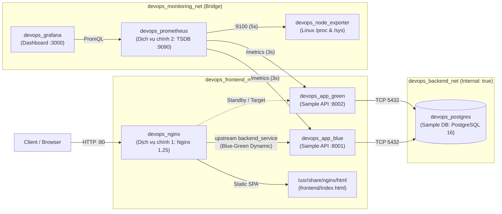
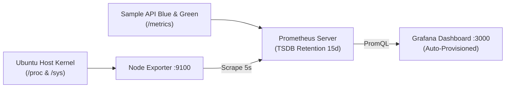

# Báo Cáo Kỹ Thuật Dự Án: Configure and Deploy DevOps Services in Linux

---

## 1. Tổng Quan & Phạm Vi Đề Tài

- **Tên đề tài:** Configure and Deploy DevOps Services in Linux (Đồ án môn học: Linux & Phần mềm Nguồn mở).
- **Hệ điều hành mục tiêu:** Ubuntu Server 22.04 / 24.04 LTS.
- **Định hướng tinh gọn & chuyên sâu:** Thay vì dàn trải quá nhiều công cụ dư thừa, hệ thống tập trung tối ưu và làm chủ sâu sắc **2 dịch vụ mã nguồn mở cốt lõi trên Linux**:
  1. **Dịch vụ 1 — Nginx Gateway & High Availability:** Đảm nhận Reverse Proxy, cân bằng tải (`least_conn`), chống quá tải bằng Rate Limiting (`HTTP 429`), và triển khai không gián đoạn (**Blue-Green Deployment** qua tín hiệu nhân Linux `POSIX SIGHUP`).
  2. **Dịch vụ 2 — Prometheus & Grafana Monitoring:** Giám sát toàn diện tài nguyên hệ điều hành Linux (CPU, RAM qua `Node Exporter` đọc trực tiếp từ `/proc`, `/sys`) cùng lưu lượng Request Rate và độ trễ Latency (Avg/P95) của API theo thời gian thực.
- **Thành phần hỗ trợ & Tự động hóa Linux:**
  - Ứng dụng mẫu (`FastAPI` + `PostgreSQL 16`) đóng vai trò mục tiêu kiểm thử thực tế cho Gateway và Monitoring.
  - Bộ **7 Bash Scripts** chuẩn `set -euo pipefail` tự động hóa cấu hình hệ điều hành (`sysctl`, `UFW`), quản trị dịch vụ runtime, chuyển mạch Blue-Green và sao lưu PostgreSQL định kỳ qua `crontab`.

---

## 2. Kiến Trúc Tổng Thể & Điều Phối Container (7 Services)

Hệ thống được đóng gói gọn nhẹ gồm **7 container services** phân tách trên **3 Docker bridge networks** và **3 named volumes** trong [docker-compose.yml](docker-compose.yml):

### Danh mục 7 Services & Giới hạn Cgroups v2

| Vai trò | Service | Container Name | Image | Port Mapping | Giới hạn CPU / RAM | Mạng tham gia |
| :--- | :--- | :--- | :--- | :--- | :--- | :--- |
| **Dịch vụ chính 1** | `nginx` | `devops_nginx` | `nginx:1.25-alpine` | `${HOST_HTTP_PORT:-80}:80` | `0.5 CPU` / `256 MB` | `frontend_net` |
| **Dịch vụ chính 2** | `prometheus` | `devops_prometheus` | `prom/prometheus:v2.51.0` | `${PROMETHEUS_PORT:-9090}:9090` | `0.5 CPU` / `512 MB` | `monitoring_net` |
| **Dịch vụ chính 2** | `grafana` | `devops_grafana` | `grafana/grafana:10.4.0` | `${GRAFANA_PORT:-3000}:3000` | `0.5 CPU` / `256 MB` | `monitoring_net` |
| **Dịch vụ chính 2** | `node-exporter` | `devops_node_exporter` | `prom/node-exporter:v1.7.0` | Nội bộ `:9100` | `0.2 CPU` / `128 MB` | `monitoring_net` |
| *Sample App* | `app_blue` | `devops_app_blue` | `devops-app:1.0.0` | `127.0.0.1:8001:8000` | `1.0 CPU` / `512 MB` | `backend_net`, `frontend_net`, `monitoring_net` |
| *Sample App* | `app_green` | `devops_app_green` | `devops-app:1.0.0` | `127.0.0.1:8002:8000` | `1.0 CPU` / `512 MB` | `backend_net`, `frontend_net`, `monitoring_net` |
| *Sample DB* | `db` | `devops_postgres` | `postgres:16-alpine` | `${HOST_DB_PORT:-5433}:5432` | `1.0 CPU` / `512 MB` | `backend_net`, `frontend_net` |

**Điểm nổi bật về bảo mật & tài nguyên Linux:**
- **Cgroups Resource Limits:** Mọi container đều có ngưỡng `cpus` và `memory` rõ ràng giúp ngăn chặn tiến trình rò rỉ bộ nhớ làm treo nhân Linux (OOM Killer).
- **Network Isolation:** `backend_net` được cấu hình `internal: true`; hai cổng `8001` và `8002` của `app_blue`/`app_green` chỉ bind về `127.0.0.1` phục vụ health probe cục bộ của script triển khai.
- **Log Rotation:** Driver `json-file` giới hạn `max-size: "10m"`, `max-file: "3"` tránh đầy inode ổ cứng.

---

## 3. Dịch Vụ Trọng Tâm 1: Nginx Gateway & High Availability

Tầng gateway được cấu hình tách bạch giữa nhân lõi ([nginx/nginx.conf](nginx/nginx.conf)), upstream động ([nginx/conf.d/00-upstream.conf](nginx/conf.d/00-upstream.conf)) và virtual host ([nginx/conf.d/app.conf](nginx/conf.d/app.conf)):

1. **Tối ưu hóa I/O cấp nhân Linux:**
   - Kích hoạt `use epoll;` (I/O multiplexing độ phức tạp $\mathcal{O}(1)$ thay cho `select`/`poll`), `worker_processes auto;`, `worker_rlimit_nofile 65535;`, `worker_connections 2048;`, `multi_accept on;`.
   - Tối ưu truyền tải socket: `sendfile on;`, `tcp_nopush on;`, `tcp_nodelay on;`, nén `gzip` cấp độ `6`.
2. **Bảo mật Gateway & Rate Limiting:**
   - `server_tokens off;` ẩn phiên bản Nginx, `client_max_body_size 10M;`.
   - Security Headers chuẩn OWASP: `X-Frame-Options: DENY`, `X-Content-Type-Options: nosniff`, `X-XSS-Protection: 1; mode=block`, `Referrer-Policy`.
   - **Rate Limiting chống DoS:** `limit_req_zone $binary_remote_addr zone=api_limit_ip:10m rate=15r/s;` với `burst=10 nodelay` cho `/api/` và `burst=15 nodelay` cho `/`, phản hồi JSON lỗi `429 Too Many Requests`.
   - Endpoint `/metrics` chỉ cho phép truy cập từ `127.0.0.1` và các dải mạng nội bộ (`172.16.0.0/12`, `10.0.0.0/8`, `192.168.0.0/16`).
3. **Chuyển mạch Blue-Green Zero-Downtime ([scripts/blue_green_deploy.sh](scripts/blue_green_deploy.sh)):**
   - Xác định node đang Active (`app_blue` hoặc `app_green`), khởi chạy node Idle còn lại với phiên bản mới.
   - Chạy **5 lần HTTP Healthcheck Probe** vào `127.0.0.1:8001|8002/health`. Nếu lỗi, tự động dừng node mới và giữ nguyên lưu lượng trên node cũ.
   - Nếu đạt chuẩn: ghi đè nguyên tử tệp [nginx/conf.d/00-upstream.conf](nginx/conf.d/00-upstream.conf), kiểm tra `nginx -t`, và gửi tín hiệu **`POSIX SIGHUP`** (`nginx -s reload`) để nạp Worker process mới mà **không ngắt bất kỳ kết nối TCP nào (0ms downtime)**.
   - Thực hiện **Graceful Connection Draining (5s)** rồi mới `docker compose stop` container cũ để giải phóng RAM.

---

## 4. Dịch Vụ Trọng Tâm 2: Giám Sát Hệ Thống (Prometheus & Grafana)

- **Node Exporter:** Gắn read-only hệ thống tệp ảo `/proc`, `/sys` và `/` của máy chủ Ubuntu để thu thập chính xác mức tải CPU (`node_cpu_seconds_total`) và bộ nhớ RAM (`node_memory_MemTotal_bytes`, `node_memory_MemAvailable_bytes`).
- **Prometheus ([monitoring/prometheus/prometheus.yml](monitoring/prometheus/prometheus.yml)):** Thu thập chỉ số OS từ `node_exporter` mỗi **5s** và số liệu HTTP từ `app_blue:8000`, `app_green:8000` mỗi **3s**; lưu trữ dữ liệu chuỗi thời gian (TSDB) trong **15 ngày**.
- **Grafana Auto-Provisioning ([devops_overview.json](monitoring/grafana/provisioning/dashboards/devops_overview.json)):** Nạp sẵn datasource `Prometheus` và dashboard **DevOps Linux Monitoring (Nginx & OS Metrics)** với **4 biểu đồ cốt lõi** (làm mới mỗi 5s):
  1. **Linux Host CPU Usage (%)** — theo dõi tải CPU toàn hệ thống.
  2. **Linux Host Memory Usage (MB)** — theo dõi lượng RAM thực tế đang sử dụng.
  3. **Nginx & FastAPI Request Rate by Status Code (req/s)** — phân tách lưu lượng thành công `HTTP 200` và lưu lượng bị Nginx chặn `HTTP 429`.
  4. **API Request Latency (Avg & P95 ms)** — đo độ trễ trung bình và bách phân vị thứ 95 từ `http_request_duration_seconds_bucket`.

---

## 5. Ứng Dụng Mẫu (Sample App), CI/CD & Bash Automation

### 5.1. Sample Application & Web Dashboard
- **Backend ([app/main.py](app/main.py)):** FastAPI (`fastapi==0.110.0`) chạy với Uvicorn 2 workers, cung cấp endpoint `/health`, `/metrics`, CRUD `/api/v1/items` nối PostgreSQL 16 và API thông số hệ thống `/api/v1/devops/system-stats`. Đóng gói Multi-stage Dockerfile ([app/Dockerfile](app/Dockerfile)) chạy dưới user không đặc quyền `appuser` (UID `10001`).
- **Web Dashboard ([frontend/index.html](frontend/index.html)):** Giao diện Tailwind CSS + Alpine.js trực quan hóa trạng thái 7 containers, node Blue/Green đang hoạt động, thao tác CRUD PostgreSQL và các nút demo Stress Test / Health Probe.
- **Unit Tests ([app/tests/test_main.py](app/tests/test_main.py)):** 5 test cases kiểm tra root, `/metrics`, `/health`, `system-stats` và `/api/v1/items` bằng `pytest`.

### 5.2. Pipeline CI/CD Tự Động
Thiết lập qua [.gitea/workflows/deploy.yaml](.gitea/workflows/deploy.yaml) và [.github/workflows/deploy.yaml](.github/workflows/deploy.yaml) gồm 3 giai đoạn:
1. **Lint & Unit Test:** Chạy `flake8` kiểm tra PEP8/syntax và `pytest` cho 5 unit tests.
2. **Security Gate:** Quét lộ secret bằng `Gitleaks` và quét lỗ hổng image mức `CRITICAL` bằng `Aqua Trivy` (chặn deploy nếu có lỗ hổng nghiêm trọng).
3. **Blue-Green Deploy:** Build image gắn tag commit SHA và gọi `./scripts/blue_green_deploy.sh` tự động chuyển mạch, kiểm tra health và báo kết quả qua Telegram Bot.

### 5.3. Bộ Tập Lệnh Bash Quản Trị Hệ Thống Linux

| Script | Vai trò & Cơ chế Linux áp dụng |
| :--- | :--- |
| [scripts/setup_server.sh](scripts/setup_server.sh) | Bootstrap Ubuntu Server: cài `ufw`, `fail2ban`, Docker CE; thiết lập firewall UFW (`22, 80, 443, 3000`); cài crontab backup `02:00`; tối ưu kernel tại `/etc/sysctl.d/99-devops.conf` (`somaxconn=65535`, `tcp_tw_reuse=1`, `fs.file-max=2097152`). |
| [scripts/service_manager.sh](scripts/service_manager.sh) | CLI quản trị runtime (Menu 9 mục hoặc cờ dòng lệnh): `status` (`docker stats`, `ss -tulpn`), `start`, `stop`, `set-port`, `switch-env`, `reload` (`nginx -t` + `nginx -s reload`), `deploy-bg`, `logs`. |
| [scripts/blue_green_deploy.sh](scripts/blue_green_deploy.sh) | Tự động triển khai Blue-Green, probe 5 lần, chuyển `00-upstream.conf`, reload Nginx qua `SIGHUP`, drain 5s và tắt node cũ. |
| [scripts/auto_backup.sh](scripts/auto_backup.sh) | Chạy qua `cron`: `docker exec devops_postgres pg_dump \| gzip -9`, phân quyền chặt `chmod 700/600`, tạo `sha256sum`, dọn bản cũ > 7 ngày (`find -mtime +7 -delete`), gửi báo cáo Telegram. |
| [scripts/healthcheck_rollback.sh](scripts/healthcheck_rollback.sh) | Probe `/health` sau triển khai (3 lần, mỗi 4s) và rollback tự động nếu dịch vụ gặp lỗi. |
| [scripts/benchmark_stress.sh](scripts/benchmark_stress.sh) | Bắn 500 requests (concurrency 15) qua `ab` hoặc `curl` để demo Rate Limiting `HTTP 429` và biểu đồ Grafana. |
| [scripts/generate_ssl.sh](scripts/generate_ssl.sh) | Sinh cặp khóa RSA 2048-bit & chứng chỉ X.509 self-signed bằng `openssl` (`chmod 600` cho private key). |

---

## 6. Phân Công Nhiệm Vụ Nhóm 3 Thành Viên

| Thành viên | Phụ trách chính | Công việc cụ thể |
| :--- | :--- | :--- |
| **Thành viên 1** | **Dịch vụ 1: Nginx Gateway & High Availability** | Cấu hình Nginx (`epoll`, Rate Limiting, OWASP headers), kiến trúc Blue-Green (`00-upstream.conf`), script `blue_green_deploy.sh` và kịch bản Stress Test. |
| **Thành viên 2** | **Dịch vụ 2: Prometheus & Grafana Monitoring** | Cấu hình `Node Exporter`, `prometheus.yml`, viết truy vấn PromQL và thiết kế Dashboard Grafana tự động (`CPU`, `RAM`, `Request Rate`, `Latency`). |
| **Thành viên 3** | **Hạ tầng Linux, Tự động hóa & Sample App** | Hardening Ubuntu Server (`setup_server.sh`), `docker-compose.yml` (Cgroups & Networks), script `service_manager.sh`, `auto_backup.sh` (`cron`), Sample App & CI/CD. |
