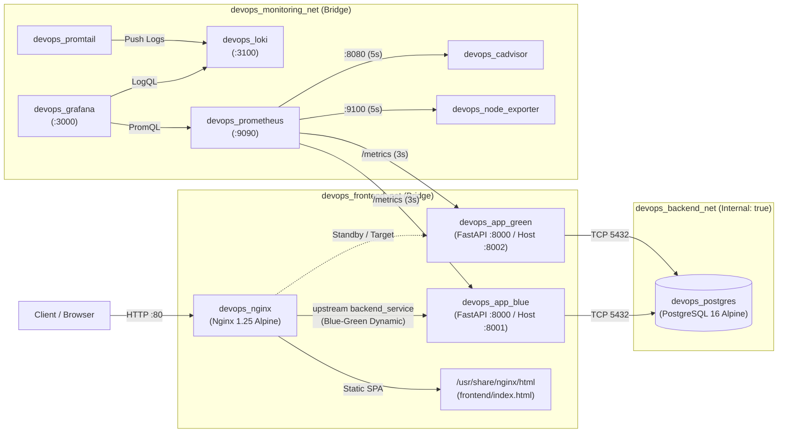
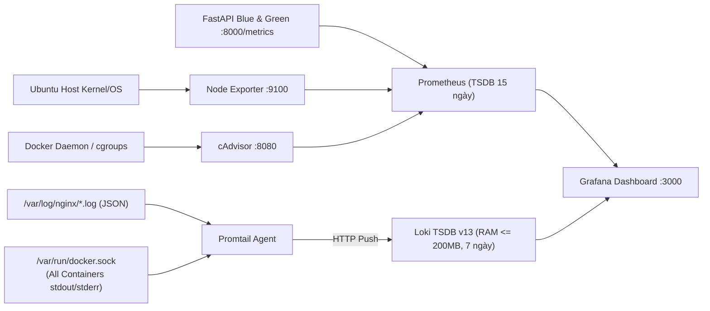
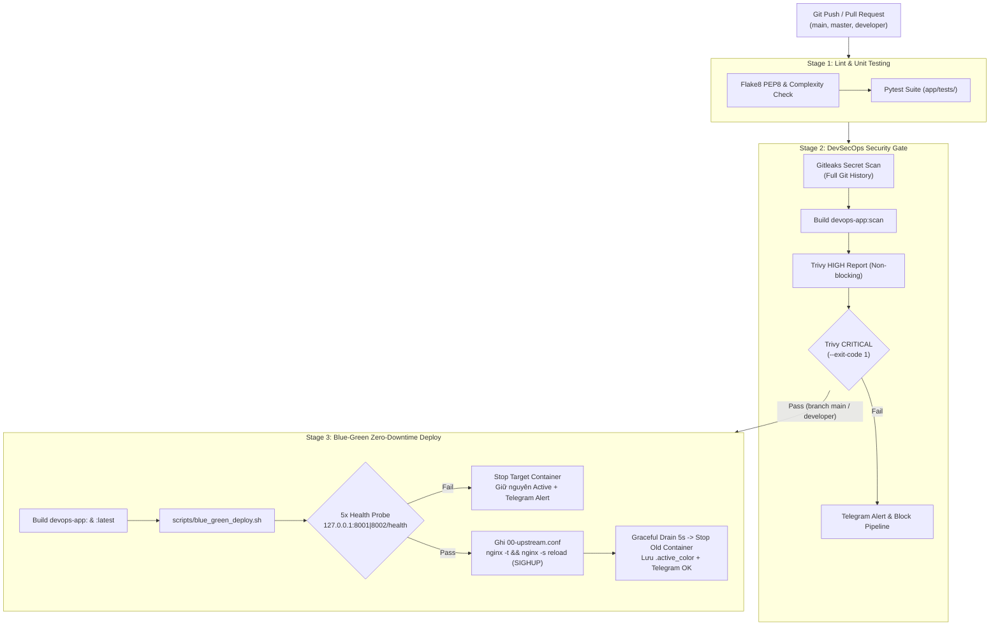

# Báo Cáo Kỹ Thuật Toàn Diện Dự Án: Configure and Deploy DevOps Services in Linux

> [!NOTE]
> Báo cáo này được tổng hợp trực tiếp từ mã nguồn, tệp cấu hình, pipeline CI/CD và tập lệnh vận hành của dự án (nhánh `main`, commit `821323e`).

---

## 1. Tổng Quan Dự Án

- **Tên đề tài:** Configure and Deploy DevOps Services in Linux (Đồ án môn học: Linux & Phần mềm nguồn mở).
- **Hệ điều hành mục tiêu:** Ubuntu Server 22.04 / 24.04 LTS.
- **Mục tiêu cốt lõi:** Xây dựng một hệ thống dịch vụ web hoàn chỉnh theo chuẩn DevOps/DevSecOps trên Linux: đóng gói đa tầng bằng Docker Compose, phân tách mạng nội bộ, Reverse Proxy hiệu năng cao với Rate Limiting, triển khai không gián đoạn (Blue-Green Zero-Downtime Deployment), giám sát tập trung (Metrics + Logs) và tự động hóa sao lưu/phục hồi bằng Bash scripts.
- **Quy mô mã nguồn hiện tại:** 29 tệp mã nguồn & cấu hình chính (~3.039 dòng), lịch sử Git gồm 5 commits trên nhánh `main` (`origin/main`, `origin/developer`).

### Thống kê cấu phần dự án

| Nhóm thành phần | Thư mục / Tệp tiêu biểu | Công nghệ sử dụng | Tổng số dòng |
| :--- | :--- | :--- | :---: |
| **Điều phối Container** | [docker-compose.yml](docker-compose.yml), [.env.example](.env.example) | Docker Compose, Cgroups limits | 353 |
| **Backend API & Tests** | [app/main.py](app/main.py), [app/Dockerfile](app/Dockerfile), [app/tests/test_main.py](app/tests/test_main.py) | FastAPI, Uvicorn, PostgreSQL, Pytest | 394 |
| **Frontend Dashboard** | [frontend/index.html](frontend/index.html) | Tailwind CSS, Alpine.js 3.13.5 | 495 |
| **Reverse Proxy & Gateway** | [nginx/nginx.conf](nginx/nginx.conf), [nginx/conf.d/app.conf](nginx/conf.d/app.conf), [nginx/conf.d/00-upstream.conf](nginx/conf.d/00-upstream.conf) | Nginx 1.25 Alpine (`epoll`, `least_conn`) | 158 |
| **Observability Stack** | [monitoring/prometheus/prometheus.yml](monitoring/prometheus/prometheus.yml), Loki, Promtail, Grafana | Prometheus v2.51, Loki/Promtail 2.9.4, Grafana 10.4 | 326 |
| **Bash Automation Scripts** | [scripts/](scripts/service_manager.sh) (7 scripts vận hành & bảo mật) | Bash (`set -euo pipefail`), Cron, UFW, OpenSSL | 903 |
| **CI/CD & DevSecOps** | [.gitea/workflows/deploy.yaml](.gitea/workflows/deploy.yaml), [.github/workflows/deploy.yaml](.github/workflows/deploy.yaml), [.gitleaks.toml](.gitleaks.toml) | Gitea/GitHub Actions, Flake8, Gitleaks, Trivy | 314 |
| **Tài liệu** | [README.md](README.md) | Markdown | 89 |

---

## 2. Kiến Trúc Tổng Thể & Điều Phối Container

Hệ thống vận hành **10 container services** được phân tách trên **3 Docker bridge networks** và **4 named volumes** trong [docker-compose.yml](docker-compose.yml).

### Danh mục 10 Services & Giới hạn Cgroups

| Service | Container Name | Image | Port Mapping | Giới hạn CPU / RAM | Mạng tham gia |
| :--- | :--- | :--- | :--- | :--- | :--- |
| `db` | `devops_postgres` | `postgres:16-alpine` | *Không mở ra Host* | `1.0 CPU` / `512 MB` | `backend_net` |
| `app_blue` | `devops_app_blue` | `devops-app:1.0.0` | `127.0.0.1:8001:8000` | `1.0 CPU` / `512 MB` | `backend_net`, `frontend_net`, `monitoring_net` |
| `app_green` | `devops_app_green` | `devops-app:1.0.0` | `127.0.0.1:8002:8000` | `1.0 CPU` / `512 MB` | `backend_net`, `frontend_net`, `monitoring_net` |
| `nginx` | `devops_nginx` | `nginx:1.25-alpine` | `${HOST_HTTP_PORT:-80}:80` | `0.5 CPU` / `256 MB` | `frontend_net` |
| `node-exporter` | `devops_node_exporter` | `prom/node-exporter:v1.7.0` | Nội bộ `:9100` | `0.2 CPU` / `128 MB` | `monitoring_net` |
| `cadvisor` | `devops_cadvisor` | `gcr.io/cadvisor/cadvisor:v0.47.2` | Nội bộ `:8080` | `0.3 CPU` / `256 MB` | `monitoring_net` |
| `prometheus` | `devops_prometheus` | `prom/prometheus:v2.51.0` | `${PROMETHEUS_PORT:-9090}:9090` | `0.5 CPU` / `512 MB` | `monitoring_net` |
| `grafana` | `devops_grafana` | `grafana/grafana:10.4.0` | `${GRAFANA_PORT:-3000}:3000` | `0.5 CPU` / `256 MB` | `monitoring_net` |
| `loki` | `devops_loki` | `grafana/loki:2.9.4` | `3100:3100` | `0.5 CPU` / `200 MB` | `monitoring_net` |
| `promtail` | `devops_promtail` | `grafana/promtail:2.9.4` | Nội bộ `:9080` | `0.2 CPU` / `128 MB` | `monitoring_net` |

**Điểm nổi bật về bảo mật & tài nguyên:**
- **Defense in Depth ở tầng mạng:** `backend_net` đặt `internal: true`, cô lập hoàn toàn PostgreSQL khỏi Internet và các container giám sát. Hai cổng `8001` và `8002` của `app_blue`/`app_green` chỉ bind về `127.0.0.1` phục vụ health probe cục bộ của script triển khai.
- **Log Rotation:** Mọi service ứng dụng/proxy/DB sử dụng driver `json-file` với `max-size: "10m"` và `max-file: "3"` tránh đầy đĩa hệ điều hành.
- **Persistent Volumes:** Dữ liệu bền vững được tách qua `pg_data`, `prometheus_data`, `grafana_data`, `loki_data`.

---

## 3. Tầng Ứng Dụng: Backend API, Container & Frontend

### 3.1. FastAPI Backend ([app/main.py](app/main.py))
Ứng dụng xây dựng trên `fastapi==0.110.0`, chạy với `uvicorn[standard]==0.29.0` (2 worker processes), kết nối PostgreSQL qua `psycopg2-binary==2.9.9` và xuất số liệu hiệu năng qua `prometheus-client==0.20.0`.

- **Khởi tạo DB (`lifespan` → `init_db`):** Tự động tạo bảng `items (id SERIAL PRIMARY KEY, name VARCHAR(100), description TEXT, created_at TIMESTAMP)` và nạp 2 bản ghi mẫu nếu bảng đang trống.
- **Middleware APM (`prometheus_middleware`):** Đo đếm `http_requests_total` (`Counter` theo `method`, `endpoint`, `status_code`) và `http_request_duration_seconds` (`Histogram` theo `endpoint`), loại trừ endpoint `/metrics`.

| Method & Endpoint | Chức năng chính | Hành vi & Mã trạng thái |
| :--- | :--- | :--- |
| `GET /` | Root / Web UI fallback | Trả `frontend/index.html` nếu header `Accept` chứa `text/html` và tệp tồn tại; ngược lại trả JSON metadata (`version`, `environment`, `deployment_color`). |
| `GET /health` | Healthcheck Probe | Kiểm tra kết nối TCP/SQL tới PostgreSQL; trả `200` (`status: "ok"`) hoặc `503` (`status: "degraded"`). |
| `GET /metrics` | Prometheus Scrape | Xuất toàn bộ metrics định dạng Prometheus `text/plain`. |
| `GET /api/v1/items` | Liệt kê bản ghi | Truy vấn tối đa 50 bản ghi mới nhất từ bảng `items` (`503` nếu mất DB). |
| `POST /api/v1/items` | Tạo bản ghi mới | Dùng parameterized SQL (`%s`), trả `201 Created`. |
| `DELETE /api/v1/items/{item_id}` | Xóa bản ghi | Trả `200` hoặc `404` nếu không tồn tại `item_id`. |
| `GET /api/v1/devops/system-stats` | Thông số hệ thống | Trả `os_platform`, `kernel_release`, `architecture`, `python_version`, `deployment_color`, trạng thái DB, cgroups & rate limit config. |
| `POST /api/v1/devops/trigger-backup` | Demo Backup trên Web | Đọc bảng `items`, tạo chuỗi SQL trong bộ nhớ, băm `SHA-256` và trả metadata JSON (lưu ý xem mục 8 về điểm hạn chế). |

### 3.2. Multi-stage Dockerfile & Least Privilege ([app/Dockerfile](app/Dockerfile))
- **Stage 1 (`builder`):** Base `python:3.11-slim`, cài `gcc` và `libpq-dev` để biên dịch dependencies vào `/root/.local`.
- **Stage 2 (Runtime):** Chỉ cài runtime `libpq5` và `curl`, tạo user không đặc quyền `appuser` (UID `10001`, GID `10001`), sao chép mã nguồn với `--chown=appuser:appuser`, chạy container dưới quyền `USER appuser`.
- Tích hợp chỉ thị `HEALTHCHECK` kiểm tra `http://localhost:8000/health` mỗi 15 giây.

### 3.3. Kiểm thử tự động ([app/tests/test_main.py](app/tests/test_main.py))
Gồm 5 test cases sử dụng `fastapi.testclient.TestClient`:
1. `test_read_root`: kiểm tra JSON trả về từ `/`.
2. `test_metrics_endpoint`: kiểm tra `http_requests_total` xuất hiện tại `/metrics`.
3. `test_healthcheck_endpoint`: chấp nhận `200` hoặc `503` (khi chạy unit test không có DB) và kiểm tra cấu trúc JSON.
4. `test_devops_system_stats`: kiểm tra các trường thông số Linux & Cgroups.
5. `test_items_endpoint_structure`: kiểm tra `/api/v1/items` trả `200` hoặc `503`.

### 3.4. Web Dashboard & Control Center ([frontend/index.html](frontend/index.html))
Giao diện quản trị dark-mode viết bằng Tailwind CSS CDN + Alpine.js `3.13.5`:
- **Thanh điều hướng & Thẻ tổng quan:** Hiển thị `APP_ENV`, `APP_VERSION`, node đang active (`blue`/`green`), nền tảng OS/Kernel, trạng thái PostgreSQL, giới hạn Cgroups (`512 MB` / `1.0 Core`) và ngưỡng Rate Limit (`15 req/sec`).
- **Tab 1 (PostgreSQL CRUD):** Form thêm tác vụ, bảng danh sách bản ghi và thao tác xóa trực tiếp qua `/api/v1/items`.
- **Tab 2 (DevOps Control Center):** 3 nút thao tác nhanh (Trigger Backup, Stress Test bắn đồng thời 40 request `fetch('/')` để kích hoạt `HTTP 429`, và Health Probe Diagnostic) cùng khung **Live Audit Console** ghi nhật ký tương tác theo thời gian thực.

---

## 4. Reverse Proxy, Load Balancing & Bảo Mật Nginx

Tầng gateway được cấu hình tách bạch giữa nhân lõi ([nginx/nginx.conf](nginx/nginx.conf)), upstream động ([nginx/conf.d/00-upstream.conf](nginx/conf.d/00-upstream.conf)) và virtual host ([nginx/conf.d/app.conf](nginx/conf.d/app.conf)):

- **Tối ưu I/O Linux:** `worker_processes auto`, `worker_rlimit_nofile 65535`, cơ chế sự kiện `use epoll`, `worker_connections 2048`, `multi_accept on`, `sendfile on`, `tcp_nopush on`, `tcp_nodelay on`, `gzip_comp_level 6`.
- **Structured JSON Logging:** Định dạng `production_json` ghi nhận `time_local`, `client_ip`, `request_method`, `request_uri`, `status`, `body_bytes_sent`, `request_time`, `upstream_response_time`, `http_user_agent` ra `/var/log/nginx/access.log` để Promtail phân tích trực tiếp.
- **Bảo mật & Chống lạm dụng:**
  - `server_tokens off`, `client_max_body_size 10M`.
  - Security headers OWASP: `X-Frame-Options: DENY`, `X-Content-Type-Options: nosniff`, `X-XSS-Protection: 1; mode=block`, `Referrer-Policy`.
  - **Rate Limiting:** `limit_req_zone $binary_remote_addr zone=api_limit_ip:10m rate=15r/s;` (trả mã `429`). Áp dụng `burst=10 nodelay` cho `/api/` và `burst=15 nodelay` cho `/`, trả JSON lỗi chuẩn hóa cho `429` và `502/503/504`.
  - **Kiểm soát truy cập `/metrics`:** Chỉ cho phép `127.0.0.1` và các dải private (`172.16.0.0/12`, `10.0.0.0/8`, `192.168.0.0/16`), từ chối toàn bộ truy cập công khai.
  - **Blue-Green Upstream:** Sử dụng thuật toán `least_conn`, `keepalive 32`, `max_fails=3 fail_timeout=10s`, cho phép `blue_green_deploy.sh` chuyển đổi target giữa `app_blue:8000` và `app_green:8000` mà không làm rớt kết nối.

---

## 5. Hệ Thống Giám Sát & Thu Thập Log Tập Trung (Observability)

- **Prometheus ([monitoring/prometheus/prometheus.yml](monitoring/prometheus/prometheus.yml)):** Thu thập `node_exporter` và `cadvisor` mỗi **5s**, thu thập `fastapi_app` (`app_blue:8000`, `app_green:8000`) mỗi **3s**; lưu trữ TSDB tối đa **15 ngày**.
- **Loki ([monitoring/loki/loki-config.yml](monitoring/loki/loki-config.yml)):** Sử dụng schema `v13` lưu trên filesystem (`tsdb`), bật compactor tự động xóa log sau **168 giờ (7 ngày)**, giới hạn cache `32 MB` và `ingestion_rate_mb: 4` để giữ container vận hành ổn định trong ngưỡng RAM `200 MB`.
- **Promtail ([monitoring/promtail/promtail-config.yml](monitoring/promtail/promtail-config.yml)):**
  - Job `nginx-access`: Parse JSON log từ Nginx, trích xuất và đánh index label `status`, `method` phục vụ truy vấn LogQL nhanh (ví dụ `{status="429"}`), chuẩn hóa timestamp RFC3339.
  - Job `docker-containers`: Tự động phát hiện container qua `docker.sock`, gán label `container` và `stream`, đồng thời loại trừ chính `devops_promtail` và `devops_loki` để tránh vòng lặp log.
- **Grafana Auto-Provisioning ([devops_overview.json](monitoring/grafana/provisioning/dashboards/devops_overview.json)):** Tự động nạp sẵn 2 datasource (`Prometheus` mặc định và `Loki`) cùng dashboard *DevOps Linux Full Observability (Metrics & Logs)* gồm 5 panels (Host CPU %, Host Memory MB, FastAPI Request Rate by Status Code, Container Memory Usage và Centralized Live Logs Stream có bộ lọc `$search`).

---

## 6. Quy Trình CI/CD, DevSecOps & Triển Khai Blue-Green

Cả [.gitea/workflows/deploy.yaml](.gitea/workflows/deploy.yaml) và [.github/workflows/deploy.yaml](.github/workflows/deploy.yaml) đều thiết lập quy trình 3 giai đoạn khi `push` (`main`, `master`, `developer`) hoặc `pull_request` (`main`, `developer`):

---

## 7. Tập Lệnh Tự Động Hóa & Quản Trị Hệ Thống Linux

| Script | Dòng | Vai trò & Cơ chế Linux áp dụng |
| :--- | :---: | :--- |
| [scripts/setup_server.sh](scripts/setup_server.sh) | 85 | Bootstrap Ubuntu Server: cài `ufw`, `fail2ban`, Docker CE & Compose plugin; cấu hình UFW (`deny incoming`, mở `22, 80, 443, 3000`); cài crontab backup lúc `02:00`; tối ưu kernel tại `/etc/sysctl.d/99-devops.conf` (`somaxconn=65535`, `tcp_max_syn_backlog=65535`, `tcp_tw_reuse=1`, `fs.file-max=2097152`, `fs.inotify.max_user_watches=524288`). |
| [scripts/service_manager.sh](scripts/service_manager.sh) | 274 | CLI quản trị đa năng (Interactive menu 9 mục hoặc tham số dòng lệnh): `status` (kiểm tra `docker stats` & `ss -tulpn`), `start`, `stop`, `set-port`, `switch-env`, `reload` (`nginx -t` + `nginx -s reload`), `deploy-bg`, `logs`. |
| [scripts/blue_green_deploy.sh](scripts/blue_green_deploy.sh) | 204 | Điều phối chuyển mạch Blue-Green: xác định node active, khởi động target, thực hiện 5 lần HTTP probe, chuyển upstream và nạp lại Nginx bằng SIGHUP, chờ 5s draining rồi dừng container cũ, thông báo Telegram. |
| [scripts/auto_backup.sh](scripts/auto_backup.sh) | 123 | Chạy `docker exec devops_postgres pg_dump \| gzip -9`, thiết lập phân quyền chặt (`chmod 700` thư mục, `chmod 600` file `.sql.gz`), tạo `sha256sum`, xóa bản cũ hơn `BACKUP_RETENTION_DAYS` (mặc định 7 ngày), gửi báo cáo Telegram. |
| [scripts/healthcheck_rollback.sh](scripts/healthcheck_rollback.sh) | 129 | Kiểm tra `/health` sau triển khai (3 lần thử, mỗi 4s), cập nhật `.last_stable_tag` hoặc rollback + gửi 5 dòng log cuối qua Telegram. |
| [scripts/benchmark_stress.sh](scripts/benchmark_stress.sh) | 53 | Gửi 500 requests (concurrency 15) qua Apache Benchmark (`ab`) hoặc `curl` song song để demo Rate Limiting `HTTP 429` và biểu đồ Grafana. |
| [scripts/generate_ssl.sh](scripts/generate_ssl.sh) | 35 | Sinh cặp khóa RSA 2048-bit & chứng chỉ X.509 self-signed (`nginx/ssl/selfsigned.key` với `chmod 600` và `.crt` với `chmod 644`). |

---

## 8. Kết Quả Kiểm Toán Kỹ Thuật & Điểm Cần Hoàn Thiện

Trong quá trình rà soát toàn bộ mã nguồn và kiểm tra môi trường thực tế (`pytest` chưa được cài trên host và `docker compose ps` hiện chưa có container đang chạy), dự án đạt kiến trúc rất hoàn chỉnh nhưng có **6 điểm sai lệch/lỗi kỹ thuật cụ thể** cần xử lý để vận hành trơn tru trên production:

> [!WARNING]
> **1. Tham chiếu service `app` cũ chưa cập nhật sau khi tách Blue-Green (`app_blue` / `app_green`)**
> - Trong [scripts/service_manager.sh](scripts/service_manager.sh#L157), lệnh `switch_environment` gọi `docker compose up -d --no-deps app`.
> - Trong [scripts/healthcheck_rollback.sh](scripts/healthcheck_rollback.sh#L111-L119), kịch bản rollback gọi `logs --tail=20 app`, cập nhật `APP_CONTAINER_IMAGE` và `docker compose up -d --no-deps app`.
> - Do `docker-compose.yml` chỉ định nghĩa `app_blue` và `app_green`, hai lệnh trên sẽ báo lỗi `no such service: app` khi thực thi.

> [!WARNING]
> **2. Lỗi chính tả đường dẫn `--config` của Gitleaks trong CI/CD Workflow**
> - Cả [.gitea/workflows/deploy.yaml](.gitea/workflows/deploy.yaml#L72) và [.github/workflows/deploy.yaml](.github/workflows/deploy.yaml#L72) đều ghi `--config="/repo/.giteaks.toml"` (thiếu chữ `l` so với tên tệp thật [.gitleaks.toml](.gitleaks.toml)). Điều này làm lệnh thứ nhất lỗi và fallback sang lệnh không dùng allowlist, có nguy cơ báo false-positive với `.env.example` và `README.md`.

3. **Cập nhật biến `.env` trong [scripts/blue_green_deploy.sh](scripts/blue_green_deploy.sh#L103-L109):**
   - Lệnh `sed -i "s/^APP_GREEN_VERSION=.../" "$ENV_FILE" || echo ... >> "$ENV_FILE"` có nhược điểm là `sed -i` vẫn trả về mã thoát `0` khi không tìm thấy dòng phù hợp, nên phần `|| echo` sẽ không chạy. Do [.env.example](.env.example) hiện chưa khai báo 4 biến `APP_BLUE_VERSION`, `APP_BLUE_IMAGE`, `APP_GREEN_VERSION`, `APP_GREEN_IMAGE`, script sẽ không ghi được tag mới vào `.env` nếu người dùng tạo `.env` từ `.env.example`.

4. **Regex cAdvisor trong Dashboard Grafana ([devops_overview.json](monitoring/grafana/provisioning/dashboards/devops_overview.json#L64)):**
   - Truy vấn `container_memory_usage_bytes{name=~"app|nginx|db|loki|promtail"}` khớp theo chuỗi đầy đủ trong PromQL, trong khi tên container thực tế là `devops_app_blue`, `devops_nginx`, `devops_postgres`, `devops_loki`, `devops_promtail`. Cần đổi thành `name=~".*(app|nginx|postgres|loki|promtail).*"` để hiển thị dữ liệu.

5. **Endpoint Web Backup & Liên kết Frontend:**
   - `POST /api/v1/devops/trigger-backup` trong [app/main.py](app/main.py#L241-L275) chỉ dựng chuỗi SQL giả lập trong bộ nhớ (không tạo file `.sql.gz` thực tế trên disk như `auto_backup.sh`) và ghép chuỗi trực tiếp `'{r['name']}'` dễ lỗi nếu dữ liệu chứa ký tự `'`.
   - [frontend/index.html](frontend/index.html#L78-L86) gắn cứng URL `http://localhost:3000` và `http://localhost:9090`, chỉ hoạt động khi truy cập từ chính máy server; nếu demo từ máy trạm khác qua IP Ubuntu Server, link sẽ trỏ về `localhost` của máy client.

6. **Chứng chỉ SSL chưa nối vào Nginx & Đồng bộ tài liệu:**
   - [scripts/generate_ssl.sh](scripts/generate_ssl.sh) tạo chứng chỉ trong `nginx/ssl/`, nhưng [docker-compose.yml](docker-compose.yml#L148-L160) chưa mở cổng `443:443` / mount `./nginx/ssl` và [nginx/conf.d/app.conf](nginx/conf.d/app.conf) chưa cấu hình `listen 443 ssl`.
   - [README.md](README.md) chưa liệt kê `benchmark_stress.sh`, `generate_ssl.sh`, và `.github/workflows/deploy.yaml` trong cây thư mục mô tả.

---

## 9. Đề Xuất Hành Động Tiếp Theo (Action Plan)

| Ưu tiên | Hạng mục khắc phục | Tệp cần chỉnh sửa |
| :---: | :--- | :--- |
| **Cao** | Sửa lỗi chính tả `.giteaks.toml` → `.gitleaks.toml` trong CI/CD workflows | [.gitea/workflows/deploy.yaml](.gitea/workflows/deploy.yaml), [.github/workflows/deploy.yaml](.github/workflows/deploy.yaml) |
| **Cao** | Cập nhật `service_manager.sh` (`switch_environment`) và `healthcheck_rollback.sh` để hỗ trợ `app_blue` / `app_green` | [scripts/service_manager.sh](scripts/service_manager.sh), [scripts/healthcheck_rollback.sh](scripts/healthcheck_rollback.sh) |
| **Cao** | Bổ sung `APP_BLUE_*` / `APP_GREEN_*` vào `.env.example` và dùng hàm upsert biến an toàn trong `blue_green_deploy.sh` | [.env.example](.env.example), [scripts/blue_green_deploy.sh](scripts/blue_green_deploy.sh) |
| **Trung bình** | Sửa regex cAdvisor trong Grafana dashboard (`.*(app\|nginx\|postgres\|loki\|promtail).*`) | [monitoring/grafana/provisioning/dashboards/devops_overview.json](monitoring/grafana/provisioning/dashboards/devops_overview.json) |
| **Thấp** | Dùng `window.location.hostname` cho link Grafana/Prometheus trên UI và mount SSL `443` nếu demo HTTPS | [frontend/index.html](frontend/index.html), [docker-compose.yml](docker-compose.yml), [nginx/conf.d/app.conf](nginx/conf.d/app.conf) |

